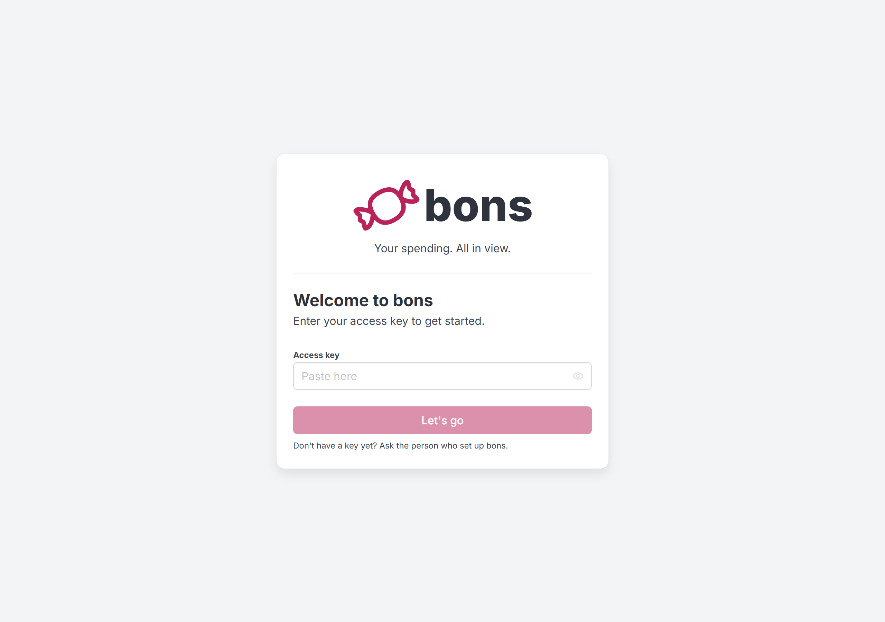
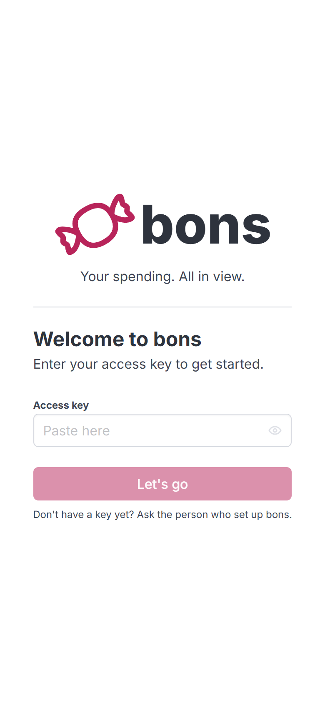
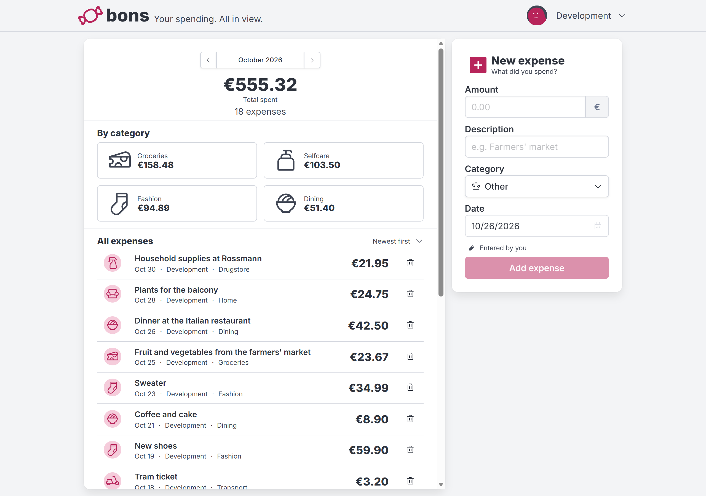
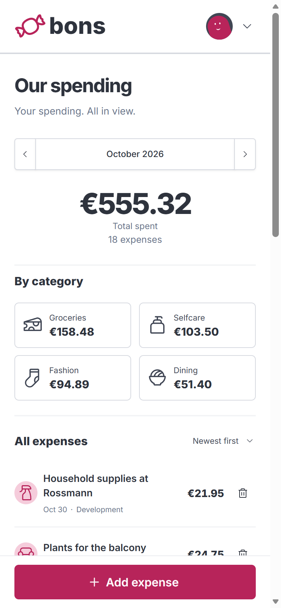

<p align="center">
  
</p>
<h1 align="center">bons</h1>
<p align="center">
  <b>Your spending. All in view.</b>
</p>

<br>

<div align="center">

[](./LICENSE)
[](https://www.rust-lang.org/)
[](https://deno.com/)
[](https://vuejs.org/)

</div>

## About

**bons** is a self-hosted receipt collection tool for keeping track of shared
spending. Enter a purchase's amount, description, category, and date, then see
your spending by month and category. It records purchases, not receipt images.

It is meant for a small, trusted group: host it privately behind an HTTPS
reverse proxy, create users yourself, and hand out their access keys in person.
There is no public registration. Everyone shares the same ledger, and every
signed-in user can view and delete all entries.

The interface works on desktop and mobile, supports English and German, and
follows your browser's light or dark color scheme. A Rust backend serves the Vue
frontend and stores everything in SQLite.

## Screenshots

Desktop and mobile views with English demo data. The images follow your
browser's light or dark color scheme.

### Login

<p align="center">
  <picture>
    <source media="(prefers-color-scheme: dark)" srcset="./media/login-desktop-dark.png">
    
  </picture>
  <picture>
    <source media="(prefers-color-scheme: dark)" srcset="./media/login-mobile-dark.png">
    
  </picture>
</p>

### Monthly spending

<p align="center">
  <picture>
    <source media="(prefers-color-scheme: dark)" srcset="./media/month-desktop-dark.png">
    
  </picture>
  <picture>
    <source media="(prefers-color-scheme: dark)" srcset="./media/month-mobile-dark.png">
    
  </picture>
</p>

## Installation

### Docker

Build the image directly from the repository URL, then start it with a
persistent database volume and bind port `2667`:

```sh
docker build -t bons https://github.com/cptpiepmatz/bons.git
docker run -d --name bons --restart unless-stopped -p 2667:2667 -v bons-data:/data bons
```

The app uses only port `2667`. Point your HTTPS reverse proxy at this port on
the Docker host, for example `http://127.0.0.1:2667` if the proxy runs there.

Create your first user:

```sh
docker exec bons bons create user "Your name" --admin
```

Save the access key printed in the terminal and use it to sign in. The database
stores only its hash, so you cannot recover a lost key from it. To add someone
else, run the command again with their name and omit `--admin` unless needed.

The container listens on `0.0.0.0:2667` and stores its database at
`/data/bons.sqlite`. Migrations run automatically. The image includes the
frontend and migrations, runs as a non-root user, and needs no separate runtime
files. Bind mounts must be writable by UID and GID `65532`; the named volume
above is initialized with the correct ownership.

### Running the binary

If you prefer not to use Docker, [build the app yourself](#building) and run the
resulting binary:

```sh
./target/release/bons create user "Your name" --admin
./target/release/bons serve
```

On Windows, use `target\release\bons.exe` instead. Run these commands with the
same database configuration and working directory.

By default, bons listens on `127.0.0.1:2667` and creates `bons.sqlite` in the
current working directory. The port spells **bons** on a T9 phone dial. Use
`serve --host <address> --port <port>` to change the listening address or port.
Put the binary behind an HTTPS reverse proxy too.

### Configuration

Configuration comes from environment variables. No `.env` file is loaded.

| Variable                | Default       | Behavior                                                                                                                                                                               |
| ----------------------- | ------------- | -------------------------------------------------------------------------------------------------------------------------------------------------------------------------------------- |
| `BONS_DATABASE`         | `bons.sqlite` | Runtime SQLite path, relative to the working directory unless absolute. The Docker image sets this to `/data/bons.sqlite`.                                                             |
| `BONS_CURRENCY`         | `EUR`         | Currency used to display all amounts, for example `USD`. Blank values are rejected. Unknown codes are preserved but produce a startup warning. This does not convert existing amounts. |
| `BONS_INSECURE_COOKIES` | Unset         | Disables Secure session cookies whenever set, even to `0`. Only use this for local HTTP; leave it unset in production.                                                                 |

For Docker, pass variables with `-e`, for example `-e BONS_CURRENCY=USD`, before
the image name in `docker run`. Keep your SQLite database on persistent storage
and make regular backups. Stop the server before copying the database, or use a
SQLite-aware backup tool, and back it up before upgrading.

### Install on a phone

bons includes a web app manifest so you can add it to your home screen. On
iPhone, open the HTTPS site in Safari and choose **Share → Add to Home Screen**.
On Android, use **Install app** or **Add to Home screen** in Chrome's menu.
Browser support and wording vary.

The installed app still needs a connection to your server. There is no offline
mode or service worker.

## Building

Install these tools and make sure they are available on `PATH`:

- [Deno 2](https://deno.com/).
- [Rust and Cargo](https://rustup.rs/) using a current stable toolchain.
- [SQLx CLI](https://github.com/launchbadge/sqlx/tree/main/sqlx-cli) with SQLite
  support:

  ```sh
  cargo install sqlx-cli --version 0.9.0 --locked --no-default-features --features sqlite
  ```

Then, from the repository root:

```sh
deno task build
```

The task prepares the build database, generates frontend assets, and compiles
the release backend. The result is `target/release/bons` (`bons.exe` on
Windows), with frontend assets and migrations embedded.

The compile-time database at `target/sqlx.sqlite` is separate from your runtime
database. If you run Cargo directly, run `deno task db:prepare` first. For a
complete release build, use `deno task build` so the embedded frontend is up to
date.

## Development

All build and development steps are defined as [Deno tasks](./deno.jsonc). With
the build tools installed, run:

```sh
deno task dev
```

This generates the frontend's dependencies, prepares and seeds a development
database, and starts Vite at `http://127.0.0.1:5173`. Vite proxies `/api`
requests to the backend at `http://127.0.0.1:2667`.

Sign in with this development-only access key:

```text
bons2667-all-your-receipts-are-belong-to-us
```

**Never use this public key in production.** Each invocation recreates the
disposable database at `target/dev.sqlite`, removing all previous development
users, entries, and sessions. It does not touch the default `bons.sqlite`. Stop
the development backend before resetting the database.

Seed data includes purchases across the current and five previous UTC months.
Descriptions follow the first supported English or German OS language, falling
back to English. To use English demo data, set `BONS_SEED_LOCALE=en` before
running `deno task dev`. The interface independently follows your browser's
language preferences.

Format the project with:

```sh
deno task fmt
```

Run the existing tests with `deno task test`. Browser icons are generated from
`logo/logo.svg`; after changing the logo during development, rerun
`deno task build:favicon` and refresh the browser.

## Security

bons uses a custom authentication implementation. It may have mistakes, and it
is not intended as a public service for untrusted users. Keep it private, share
keys carefully, and use it only with people you trust with the entire ledger.

- **HTTPS is required for deployment.** Authentication uses Secure, HttpOnly,
  SameSite=Lax session cookies. Signing in over ordinary HTTP will not work
  reliably outside localhost. Terminate HTTPS at your reverse proxy and leave
  `BONS_INSECURE_COOKIES` unset.
- **Access keys are credentials.** Keep them somewhere safe. Only hashes are
  stored in the database, and there is no key recovery flow.
- **Sessions expire after 30 days of inactivity.** Signing out revokes the
  current session, but there is no CLI or web interface for rotating access
  keys, disabling users, or revoking all of a user's sessions.
- **Manual account management needs care.** If a key is compromised, stop the
  server, back up the database, and update it with a SQLite tool. Setting the
  user's `enabled` field to `0` blocks both their key and existing sessions;
  deleting their rows from `sessions` alone does not invalidate the access key.

For local HTTP development, `.cargo/config.toml` sets `BONS_INSECURE_COOKIES=1`
for Cargo commands. This is not baked into the release binary; keep the variable
unset when running it in production.

## License

**bons** is released under the [MIT License](./LICENSE).
